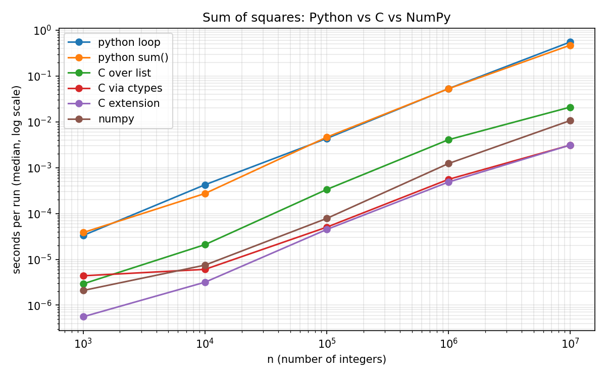

# Python Libraries Implemented in C

COMP 211 Checkoff 3 (Fall 2026): an exploration of how Python libraries like NumPy get C speed, and what that costs.

Python is known as a slow language, yet most data science and machine learning code is written in it. The trick is that the heavy lifting does not happen in Python at all. Libraries such as NumPy are thin Python layers over compiled C. This repo calls C from Python two different ways, then measures where the speed actually comes from.

## What's in here

| # | Script | Question it answers |
|---|--------|---------------------|
| 1 | `python/01_hello_ctypes.py` | How do I call a plain C function from Python? |
| 2 | `python/02_types_matter.py` | What happens if Python and C disagree about types? |
| 3 | `python/03_shared_memory.py` | Is a NumPy array really just a C array? How is a list different? |
| 4 | `python/04_benchmark.py` | Python loop vs C vs NumPy: how big is the gap, and why? |
| 5 | `python/05_crossing_cost.py` | Is calling C always faster than Python? |
| 6 | `python/06_overflow.py` | Does NumPy inherit C's fixed-width integer behavior? |
| 7 | `python/07_inside_numpy.py` | What is NumPy actually made of? |
| 8 | `python/08_numpy_temporaries.py` | Why did a hand-written C loop beat NumPy? |

The C code lives in `c/`:

- `c/mymath.c` is plain C with no Python headers. `make` turns it into a shared library (`libmymath.dylib` on macOS, `libmymath.so` on Linux) that Python loads at runtime with **ctypes**.
- `c/fastmath_module.c` is a **CPython extension module**. It includes `Python.h`, so after compiling, Python can just `import fastmath`. NumPy's core is built the same way, only much bigger.

## How to run it

You need a C compiler (`cc`/`gcc`/`clang`), Python 3 with its development headers (tested with 3.12), and `pip install numpy pytest matplotlib` (matplotlib is only used for the chart).

```sh
make                 # compile both C libraries into build/
cd python
python3 01_hello_ctypes.py     # run any experiment, 01 through 08
cd ..
make test            # build, then run the test suite (37 tests)
make bench           # full benchmark, about a minute; writes results/
make clean
```

Tested on macOS (Apple M2, Python 3.12.2, NumPy 2.2.6, Apple clang 21). The Makefile has a Linux branch (`.so`, no `-undefined dynamic_lookup`) that has not been tested yet.

## Discoveries

### 1. A NumPy array is a C array. A Python list is not.

`03_shared_memory.py` hands C a pointer into a NumPy array. C doubles every element, and Python sees `[1 2 3 4 5]` become `[2 4 6 8 10]` with no copy. The array's elements sit exactly 8 bytes apart in memory, just like `int64_t values[5]` in C.

A Python list stores *pointers* to separate int objects scattered around the heap, and each of those objects is 28 bytes (a header plus the value). One million integers:

| Storage | Memory |
|---------|--------|
| Python list | 8.4 MB of pointers + 28.0 MB of int objects |
| NumPy int64 array | 8.0 MB |

### 2. The speed comes from the loop running in C over raw numbers

Sum of squares over n = 10,000,000 integers (median of 5 runs, full table in `results/benchmark-output.txt`):

| Method | Time | vs Python loop |
|--------|------|----------------|
| Python `for` loop | 555.8 ms | 1x |
| Python `sum()` + generator | 473.4 ms | 1.2x |
| C walking a Python list | 21.0 ms | 26x |
| NumPy `(arr * arr).sum()` | 10.7 ms | 52x |
| C loop via ctypes | 3.1 ms | 178x |
| C loop via extension module | 3.1 ms | 178x |



The most interesting row is **C walking a Python list**. It is C code, but it still has to follow a pointer and "unbox" a Python int object for every element, so it is about 7x slower than the same C loop over a raw array. Switching languages alone is not enough. The data layout matters just as much.

**Fairness check:** converting the list into a NumPy array took 515.7 ms, about as long as the whole Python loop. If your data starts as a list and you only use it once, NumPy barely helps. The win comes when the data lives in an array from the start.

### 3. Calling C for one tiny operation is *slower* than Python

`05_crossing_cost.py` adds two numbers one million times:

| Call | Cost per call |
|------|---------------|
| `a + b` in Python | 10.3 ns |
| a Python function | 24.2 ns |
| C extension `fastmath.add(a, b)` | 48.1 ns |
| ctypes `lib.add(a, b)` | 294.3 ns |
| `np.add(a, b)` on single numbers | 604.6 ns |
| **one** NumPy call adding a million pairs | **0.69 ns per addition** |

Every trip from Python into C has to convert Python objects into C values and back. That costs much more than one addition. NumPy is fast only when one call does millions of operations. Using NumPy on single numbers inside a Python loop is the slowest option on this list.

### 4. NumPy is not the speed limit

The hand-written C loop beat `(arr * arr).sum()` by about 3x. `08_numpy_temporaries.py` shows why: NumPy runs one C loop per operation. `arr * arr` writes every square into a brand new 80 MB temporary array, and `.sum()` reads it all back.

| n = 10,000,000 | Time |
|----------------|------|
| `(arr * arr).sum()` | 9.2 ms |
| `arr * arr` alone | 7.8 ms |
| `np.dot(arr, arr)` (one pass, no temporary) | 3.4 ms |
| C `sum_squares` (one pass, no temporary) | 3.1 ms |

### 5. NumPy inherits C's integer behavior

Python ints never overflow. NumPy's integers are fixed-width C integers, so they wrap around in two's complement, silently for arrays:

```
Python: 9223372036854775807 + 1 = 9223372036854775808
NumPy:  [9223372036854775807] + 1 = [-9223372036854775808]
        0111...1 + 1 = 1000...0
```

Adding two `int8` pixel values of 100 gives -56. ctypes has the same issue in a different form. It cannot read C header files, so without declaring `restype`, calling a function that returns `1.5` came back as `0` with no error (`02_types_matter.py`). Declaring `argtypes` and `restype` is the Python equivalent of writing a function prototype.

### 6. You can see the C inside NumPy

`07_inside_numpy.py` finds 19 compiled modules inside the NumPy install. The biggest is `_core/_multiarray_umath...so` (3.35 MB), the same kind of file as `build/fastmath...so` here. `inspect.getsource(np.add)` fails with a `TypeError` because `np.add` has no Python source: it is a C "universal function" with a separate compiled loop for each type (`np.add.types`).

## Benchmark method

- All methods get the same data, and the script checks that they return the same answer before it times anything.
- Only the computation is timed; building the list or array is not (the conversion cost is reported separately).
- `timeit.autorange()` picks a loop count so each measurement lasts at least 0.2 s, and the reported number is the median of 5 measurements, which smooths out noise from other programs and CPU frequency changes.
- Results come from one machine (Apple M2). Exact numbers will differ elsewhere, but the ordering should hold.

## Repo layout

```
c/                C sources (ctypes library + extension module)
python/           experiments 01 to 08, plus common.py (loads the libraries)
tests/            pytest suite: C results match Python, every script runs
results/          benchmark output, CSV, and chart from my machine
slides/           presentation slides
RESOURCES.md      documentation and articles I used
```

## Resources

See [RESOURCES.md](RESOURCES.md).
